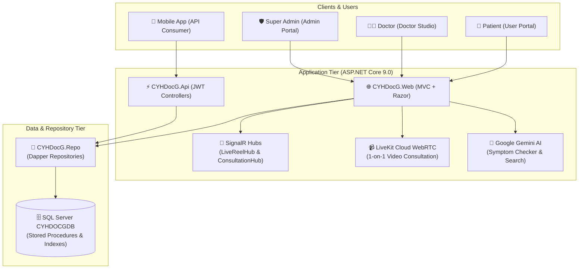
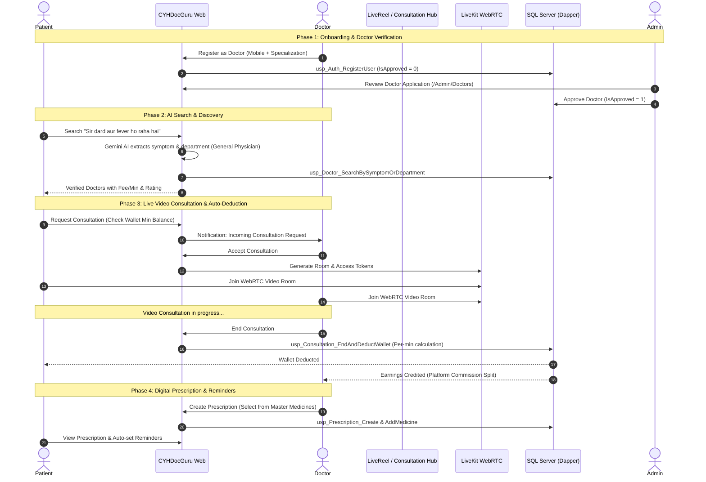

# 🏥 CYHDocGuru - Complete Project Flow Script & Architecture Guide
*(End-to-End Functional Flows, Technical Architecture, SignalR/WebRTC Lifecycle & Demo Script)*

---

## 📌 1. Project Overview & Architecture

**CYHDocGuru** ek next-generation Healthcare Telemedicine aur Interactive Doctor Live Streaming / Reels platform hai. Yeh traditional appointment booking ko modern social engagement (TikTok/Instagram-style reels & live streams) ke saath combine karta hai.

### 🏗️ Technical Stack Overview
- **Web Frontend / MVC Portal**: ASP.NET Core 9.0 MVC (Razor Views, Tailwind/Bootstrap, Responsive UI)
- **RESTful API**: ASP.NET Core 9.0 Web API with JWT Authentication (Mobile & external consumer ready)
- **Database**: Microsoft SQL Server 2022 (`CYHDOCGDB`) using high-speed **Dapper ORM** and optimized **Stored Procedures**
- **Real-Time Communication**:
  - **SignalR**: Live Chat, Real-time Comments, Pinned Health Tips, Instant Medicine Recommendation Banners
  - **LiveKit Cloud WebRTC**: Ultra low-latency 1-on-1 HD Video & Audio Consultation Rooms
- **AI Engine**: Google Gemini 3.1 Flash-Lite (`IAiSearchService`) for AI symptom search, natural language medical query understanding, and doctor ranking
- **Deployment**: Fast Incremental FTP Deployment via PowerShell (`Deploy-Live.ps1`) with MD5 content hashing



---

## 👥 2. User Roles & Permission Matrix

| Role | Access Scope | Key Capabilities |
| :--- | :--- | :--- |
| **Patient (`User`)** | `/User/*`, `/LiveDoctor/*`, `/Search/*`, `/ConsultationRoom/*` | AI Symptom search, watch doctor reels, live stream interaction, wallet top-up, book & attend video consultations, view digital prescriptions, set reminders. |
| **Doctor (`Doctor`)** | `/Doctor/*`, `/ConsultationRoom/*` | Broadcast live studio, publish reels, accept consultation requests, conduct 1-on-1 video calls, write digital prescriptions, check wallet & earnings, manage followers. |
| **Super Admin (`Admin`)** | `/Admin/*` | Approve/reject doctor KYC profiles, toggle user accounts, manage Master Medicine database, manage FAQs CMS, audit platform financial ledger & fee split. |

---

## 🔄 3. Detailed Step-by-Step Flow Scripts



---

### 🟢 Flow 1: Registration, 10-Digit Mobile Validation & Login
1. **User Registration (`/Account/Register`)**:
   - User inputs: Full Name, Email, Mobile Number, Password, Role (`User` or `Doctor`).
   - **Validation Engine**:
     - Strict 10-digit mobile number validation (Digits only, starts with 6-9).
     - Unique check on both `Phone` and `Email`.
   - **Role Execution**:
     - **Patient**: Account activated immediately (`IsActive = 1`), user redirected to login/dashboard.
     - **Doctor**: Account created in pending status (`IsApproved = 0`). Doctor can log in but cannot take paid calls or broadcast until Admin verifies credentials.
2. **Authentication Flow (`/Account/Login`)**:
   - Supports Email + Password or Google SSO.
   - On success: ASP.NET Core creates encrypted secure cookie `CYHDocGuru.Auth` with Claims (UserId, Role, Name, Email).
   - Auto-routing based on role:
     - `Admin` $\rightarrow$ `/Admin/Dashboard`
     - `Doctor` $\rightarrow$ `/Doctor/Dashboard`
     - `User` $\rightarrow$ `/User/Dashboard` or requested return URL.

---

### 🔍 Flow 2: AI Symptom Search & Doctor Matching
1. **User Query**:
   - Patient visits Home or `/Search` and types natural symptoms in plain English/Hinglish (e.g., *"Chest pain and shortness of breath"* or *"Knee swelling"*).
2. **AI Processing (`IAiSearchService` - Gemini 3.1 Flash-Lite)**:
   - Evaluates the query using prompt engineering.
   - Extracts:
     - Primary Symptoms
     - Relevant Medical Department (e.g., Cardiology, Orthopedics, Neurology)
     - Urgency level / Red flag warnings
3. **Database Match (`usp_Doctor_SearchBySymptomOrDepartment`)**:
   - Matches doctors based on specialty, qualification, experience, and approval status.
   - Results display Doctor card: Name, Photo, Qualification, Rating, Fee per minute, and Live/Online status indicator.
4. **Action**:
   - Patient can click **"Instant Consult"** or **"View Profile / Reels"**.

---

### 🎥 Flow 3: Doctor Live Reels & Streaming (Social Health Feed)
1. **Doctor Broadcast (`/Doctor/LiveStudio`)**:
   - Doctor enters Live Studio and clicks **"Start Live Stream"**.
   - Live stream entry saved in `dbo.LiveStreams`.
   - SignalR `LiveReelHub` initiates the broadcast channel.
2. **Interactive Tools inside Doctor Studio**:
   - **Pin Health Tip**: Doctor can type and pin a real-time tip (e.g., *"Take Vitamin D3 after meals"*). Instantly broadcasts to all viewers via SignalR.
   - **Recommend Medicine Banner**: Doctor can search master medicines and trigger a live floating product card with dosage info on the patient's screen.
   - **Live Comments & Q&A**: Real-time incoming patient questions appear on doctor's studio screen.
3. **Patient Experience (`/LiveDoctor` / Reels)**:
   - Infinite vertical scrolling reels format (Swipe up/down).
   - Real-time like button, comment drawer, and floating consultation request button.
   - Follow/Unfollow doctor with instantaneous count update.

---

### 📞 Flow 4: 1-on-1 Consultation & Video Call Room Flow
1. **Pre-check**:
   - Patient initiates call $\rightarrow$ System checks `dbo.UserWallets`.
   - Patient must have at least minimum balance (e.g., 5 minutes $\times$ Doctor fee/min). If insufficient, prompts instant wallet recharge modal.
2. **Consultation Initiation**:
   - SP: `usp_Consultation_CreateRequest` inserts into `dbo.Consultations` with status `'Pending'`.
   - Doctor dashboard receives audio-visual call alert.
3. **Doctor Acceptance & Room Spawn**:
   - Doctor accepts call $\rightarrow$ SP: `usp_Consultation_Accept`.
   - Backend calls `ILiveKitTokenService`:
     - Creates WebRTC room identity: `room_consultation_{id}`.
     - Issues JWT token with video/audio grant for Patient and Doctor.
   - Both parties connect to LiveKit WebRTC cloud server.
4. **Active Consultation**:
   - Two-way low latency video, audio, screen share, and SignalR consultation chat (`ConsultationHub`).
   - Live timer tracks duration in seconds.
5. **Call Conclusion & Wallet Auto-Deduction**:
   - Either party ends call or time limit reached.
   - SP: `usp_Consultation_EndAndDeductWallet` calculates exact duration in minutes:
     $$\text{Total Charge} = \text{Billed Minutes} \times \text{Doctor Fee per Minute}$$
   - **Financial Split**:
     - Patient wallet debited by `Total Charge`.
     - Platform takes commission % (configured in `AppSettings`, e.g., 20%).
     - Doctor wallet credited with net earnings (80%).
     - Transaction records logged in `dbo.WalletTransactions` and `dbo.PlatformLedger`.

---

### 💊 Flow 5: Digital Prescription & OCR Engine
1. **Prescription Authoring (`/Doctor/Prescriptions/Create`)**:
   - Doctor selects Consultation ID and Patient.
   - Autocomplete search from `dbo.MasterMedicines` (Name, Generic, Dosage, Form).
   - Inputs dosage instructions (Morning - Afternoon - Night, Food instructions, Duration in days).
   - Doctor inputs clinical notes, diagnosis, and tests required.
2. **Storage & Generation**:
   - Saved via `usp_Prescription_Create` and `usp_Prescription_AddMedicine`.
   - Auto-generates high-definition printable digital prescription with Doctor's registration number and signature.
3. **Patient Medicine Reminders**:
   - System parses prescription schedule into `dbo.MedicineReminders`.
   - Patient portal (`/User/Prescriptions`) shows active pills, countdown to next dose, and push alerts.
4. **Physical Prescription OCR**:
   - Patient can upload photo of handwritten/printed paper prescription.
   - `IOcrPrescriptionService` extracts medicine names and dosages for digital archiving.

---

### 💳 Flow 6: Wallet & Earnings Lifecycle
1. **Patient Wallet (`/User/Wallet`)**:
   - Top-up via payment gateway simulation / API (`usp_Wallet_TopUp`).
   - Real-time balance display and transaction ledger history.
2. **Doctor Wallet & Payout (`/Doctor/Earnings`)**:
   - Doctor views daily/weekly/monthly consultation revenue, live stream tips, and net earnings.
   - Request payout / bank transfer with automated ledger audit.

---

### 🛡️ Flow 7: Admin Governance & Portal Controls
1. **Doctor Verification Queue (`/Admin/Doctors`)**:
   - Admin reviews medical council registration, degree documents, and experience certificates.
   - 1-Click Approve / Reject toggle.
2. **User Moderation (`/Admin/Users`)**:
   - View all registered users with phone and email status.
   - Ability to ban/suspend abusive accounts.
3. **Master Medicine Catalog (`/Admin/Medicines`)**:
   - Add/edit medicines, compositions, and manufacturers.
4. **Dynamic FAQ CMS (`/Admin/Faqs`)**:
   - Create, edit, reorder FAQ items categorized by User, Doctor, or General.
5. **Platform Financial Ledger (`/Admin/Ledger`)**:
   - Complete visibility into all system inflow, doctor payouts, and net platform profit.

---

## 🗄️ 4. Database Execution Sequence & Entity Architecture

When setting up or resetting the database, scripts must be executed in the following sequential order:

```mermaid
flowchart LR
    S01["01: Master Tables & Schema"] --> S02["02: Auth & Security SPs"]
    S02 --> S03["03: Doctor & Live Reels SPs"]
    S03 --> S04["04: Consultation & Wallet SPs"]
    S04 --> S05["05: Prescriptions SPs"]
    S05 --> S06["06: Seed Master Data"]
    S06 --> S07["07: FAQ CMS Table & SPs"]
    S07 --> S08["08: Settings English Update"]
    S08 --> S09["09: Doctor KYC & Phone Index"]
    S09 --> S10["10: Doctors Sync Fix"]
    S10 --> S12["12: Strict 10-Digit Validation"]
    
    style S01 fill:#e1f5fe,stroke:#0288d1
    style S06 fill:#e8f5e9,stroke:#388e3c
    style S12 fill:#fff3e0,stroke:#f57c00
```



### Key Tables & Relationships
- `Users` (1) $\longleftrightarrow$ (1) `Doctors`
- `Users` (1) $\longleftrightarrow$ (1) `UserWallets`
- `Doctors` (1) $\longleftrightarrow$ (1) `DoctorWallets`
- `Users` (1) $\longleftrightarrow$ (N) `Consultations` $\longleftrightarrow$ (1) `Doctors`
- `Consultations` (1) $\longleftrightarrow$ (1) `Prescriptions` $\longleftrightarrow$ (N) `PrescriptionMedicines`
- `Doctors` (1) $\longleftrightarrow$ (N) `LiveStreams` $\longleftrightarrow$ (N) `LiveStreamComments`

---

## 🎙️ 5. Ready-to-Speak Demo / Presentation Script (Hinglish)

Use this script during a client presentation, university viva, or stakeholder review:

```text
"Hello everyone, today I'm excited to present CYHDocGuru — an advanced telemedicine platform that blends Practo-style video healthcare with modern, TikTok-style interactive doctor reels and live streaming.

[Slide / Screen 1: Home Page & AI Symptom Search]
Traditionally, patients struggle to choose the right specialist when they feel unwell. In CYHDocGuru, we integrated Google Gemini AI. A patient can simply type their symptoms in plain natural language — for example, 'Fever with severe joint pain'. The AI analyzes the symptoms and instantly routes them to the right department, like General Medicine or Rheumatology, displaying top-rated verified doctors.

[Slide / Screen 2: Doctor Reels & Live Studio]
Doctors have their own 'Doctor Studio' where they can publish short medical reels and go live. Viewers can scroll through reels, ask live questions via SignalR, and doctors can pin real-time health tips or recommend medicines right on the screen with one tap.

[Slide / Screen 3: 1-on-1 WebRTC Video Consultation]
When a patient requests a consultation, the system verifies their wallet balance. Once the doctor accepts, LiveKit WebRTC creates an encrypted, ultra-low-latency HD video room. 
As soon as the consultation ends, our Dapper stored procedures automatically calculate the duration and deduct the fee per minute from the patient wallet, splitting the earnings between the doctor and platform commission in a transparent ledger.

[Slide / Screen 4: Digital Prescriptions & Medicine Reminders]
Post-call, the doctor issues a digital prescription from our master database. The patient gets an automated medicine reminder scheduler in their dashboard so they never miss a dose.

[Slide / Screen 5: Admin & Security]
Every doctor undergoes mandatory admin KYC verification before taking calls. All user phone numbers are strictly validated, and the entire system is deployed live with high-speed Brotli compression and automated incremental deployment.

Thank you! I'm happy to demonstrate any specific live flow."
```

---

## 🚀 6. Deployment & CI/CD Pipeline

The project uses `Deploy-Live.ps1` for delta synchronization:
1. Compiles and publishes projects:
   - `CYHDocG.Web` $\rightarrow$ `publish/web`
   - `CYHDocG.Api` $\rightarrow$ `publish/api`
2. Computes MD5 checksum for every file and compares against `.deploy_manifest.json`.
3. Uploads **only modified/new files** via FTP to production server (`patnaorthoclinic.com`).
4. Updates `.deploy_manifest.json` locally to guarantee zero unnecessary network overhead and instantaneous live updates.
